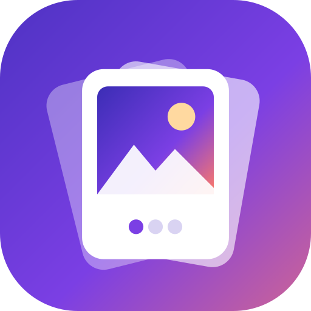

<p align="center">
  
</p>

<h1 align="center">Wallpaper Slideshow</h1>

<p align="center"><b>Your photos and videos, alive on your home screen.</b></p>

Wallpaper Slideshow is an Android live wallpaper that plays a slideshow of your own photos and videos as your phone's background, with smooth transitions and an iOS-style depth clock.

Pick some photos and/or videos, choose how they should play, tap **Set as wallpaper**, and they
will loop one after another behind your home screen (and lock screen, on most phones).

## Features

- **Photos, videos, or a mix:** pick any from your phone, Google Photos, or Files. They stay where they are; nothing is copied.
- **Order:** play in the order you set (tap an item to move it earlier or later) or shuffle.
- **Length of each video:** play each video in full, or move on after 5 to 60 seconds.
- **Photo duration:** show each photo for 3 to 60 seconds.
- **Fit to screen:** fill the screen by cropping, or show the whole photo/video with black bars.
- **Sound:** off by default; turn it on if you want the videos' audio.
- **Video speed:** 0.5× to 2×.
- **Transitions:** crossfade, fade to black, zoom, slide, or none, lasting 0.3 to 2 seconds.
- **Depth clock:** a big clock drawn by the wallpaper, with the subject of each photo or video standing in front of it (like iOS depth-effect wallpapers). Subjects are found on the phone with ML Kit (for videos, 8 cut-outs per second of the first minute, made once in the background), and photos are reframed automatically so the subject reaches into the clock.
- **Wallpaper editor:** edit right on a live preview: drag, pinch and stretch the clock, pinch and drag photos to frame them, and pick fonts, colours and glass effects from a tray.
- **A look per wallpaper:** each photo or video can have its own clock style and widgets.
- **Widgets:** weather, air quality, battery, next calendar event and a signature (in English or Arabic, in a script, Ruqaa or Kufi font, at the size you like), drawn on the wallpaper on a frosted-glass card or as plain text. Weather data: [Open-Meteo](https://open-meteo.com) (free, no account).
- **Home screen look:** after unlocking, the clock and widgets can fade away and the picture can be dimmed or blurred, so the home screen is easy to tell apart from the lock screen.
- **Gallery:** eight built-in wallpapers made for the depth clock, including two animated ones (generated by `tools/wallpapers`).
- **Battery friendly:** playback pauses when the wallpaper isn't visible (an app is open or the screen is off), audio isn't decoded while muted, and large photos are decoded at a reduced size.
- **Robust:** items that are deleted or can't be opened are skipped automatically.

Changes made in the app apply to the running wallpaper immediately.

## Install

### Download a release
1. Open the repository's **Releases** page on GitHub and pick the latest version.
2. Download `WallpaperSlideshow-vX.Y.Z.apk` on your phone and open it. Allow installing from that source if Android asks.

Builds of every commit on `main` are also available as the `WallpaperSlideshow-apk` artifact of the **Build APK** runs in the **Actions** tab.

Every build (releases included) is signed with the same key (`keystore/debug.keystore`), so new versions install
over old ones without uninstalling.

### Build it yourself
Requires JDK 17+ and the Android SDK (platform 35).

```bash
./gradlew assembleDebug
# APK: app/build/outputs/apk/debug/app-debug.apk
adb install -r app/build/outputs/apk/debug/app-debug.apk
```

## Use

1. Open **Wallpaper Slideshow**.
2. Tap **Add photos & videos** and choose one or more items.
3. Adjust the playback options.
4. Tap **Set as wallpaper**, then **Set wallpaper** on the preview screen (choose home and/or lock screen if asked).

To change the slideshow later, open the app again (or the wallpaper's *Settings* entry in your phone's wallpaper picker).

## Notes

- Some phone makers (for example Samsung) only allow live wallpapers on the home screen.
- The phone's own lock-screen clock is always drawn above any wallpaper, and apps can't remove it. On Samsung you can make it invisible: touch and hold the lock screen, tap the clock, pick a single-colour style and set its colour to fully transparent (the app guides you through this).
- The depth clock needs Google Play services, which downloads the subject-detection model the first time.
- Very high-resolution videos (4K and above) use more battery; 1080p is plenty for a background.
- Supported photo formats: JPEG, PNG, WebP, BMP, HEIF/HEIC and AVIF (as supported by the phone).

## How it works

| Part | File |
| --- | --- |
| Live wallpaper (sequences the playlist with Media3 ExoPlayer) | `app/src/main/java/com/sadikbr/videowallpaper/wallpaper/VideoWallpaperService.kt` |
| OpenGL renderer (draws video frames and photos, crop/fit, transitions) | `app/src/main/java/com/sadikbr/videowallpaper/wallpaper/SlideshowRenderer.kt` |
| Settings storage (DataStore, shared with the wallpaper) | `app/src/main/java/com/sadikbr/videowallpaper/data/SettingsRepository.kt` |
| Clock layout and depth rules (shared by wallpaper and previews) | `app/src/main/java/com/sadikbr/videowallpaper/clock/ClockPainter.kt` |
| Subject cut-outs with ML Kit | `app/src/main/java/com/sadikbr/videowallpaper/data/DepthMasks.kt` |
| Wallpaper editor (gestures, font / colour / glass tray) | `app/src/main/java/com/sadikbr/videowallpaper/ui/studio/WallpaperStudio.kt` |
| Built-in wallpapers (catalog; artwork generator in `tools/wallpapers`) | `app/src/main/java/com/sadikbr/videowallpaper/data/BuiltInWallpapers.kt` |
| Settings screen (Jetpack Compose) | `app/src/main/java/com/sadikbr/videowallpaper/ui/SettingsScreen.kt` |

The app keeps persistent read access to each chosen item (Storage Access Framework), so no storage permission is needed.

## Releasing

1. Update `versionName` (and increase `versionCode`) in `app/build.gradle.kts`.
2. Add a section for the version to `CHANGELOG.md`.
3. Push a tag such as `v1.1.0`, or run the **Release** workflow from the Actions tab and enter the version.
   It builds the APK and publishes a GitHub release (creating the tag if needed) with the APK and the changelog section.

## Brand

The icon, colours and naming are described in [docs/brand](docs/brand/README.md).

## Credits

Clock and widget fonts: Antonio, Oswald, Bebas Neue, Big Shoulders Display and Great Vibes, under the SIL Open Font License 1.1 (see `app/src/main/assets/fonts/`).
