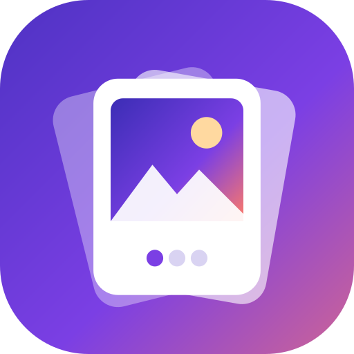

# Wallpaper Slideshow brand

## Name
**Wallpaper Slideshow**, written as two capitalised words. File names use `WallpaperSlideshow` (for example `WallpaperSlideshow-v1.1.0.apk`).

Tagline: *Your photos and videos, alive on your home screen.*

## Icon

Three photo cards fanned out like a slideshow. The front card shows a landscape and three slideshow dots, on the brand gradient.

- App icon (adaptive): `app/src/main/res/drawable/ic_launcher_background.xml` and `ic_launcher_foreground.xml`
- Themed icon (Android 13+): `app/src/main/res/drawable/ic_launcher_monochrome.xml`
- Vector for docs and the web: [`icon.svg`](icon.svg)

## Colours

| Name | Hex | Used for |
| --- | --- | --- |
| Indigo | `#3B2DB5` | Gradient start, accents on white |
| Violet | `#7B3FE4` | Gradient middle, active slideshow dot |
| Coral | `#FF7A66` | Gradient end |
| Ink | `#17123A` | Launch screen and empty-wallpaper background |

The signature gradient runs diagonally from Indigo through Violet to Coral, as on the icon and the app's header card. The app uses a fixed palette derived from these colours (`ui/theme/Theme.kt`), not the phone's wallpaper colours, so it always looks the same.
